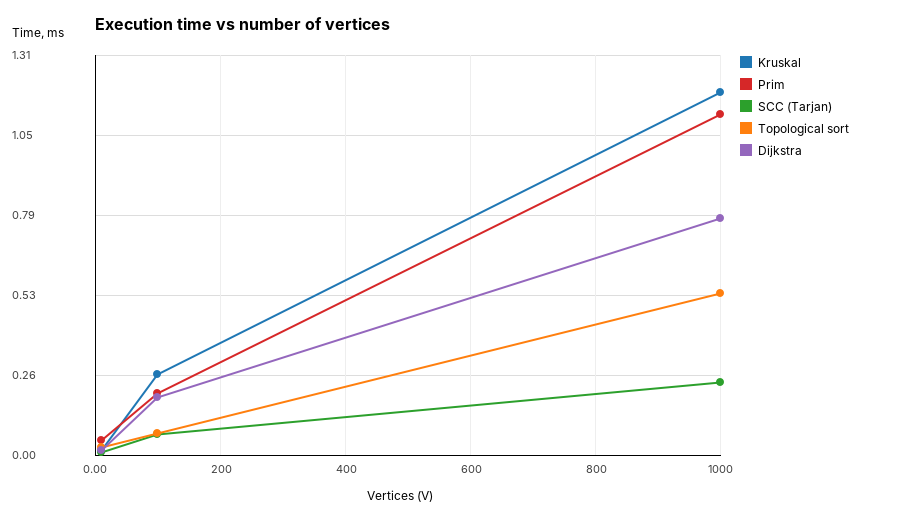
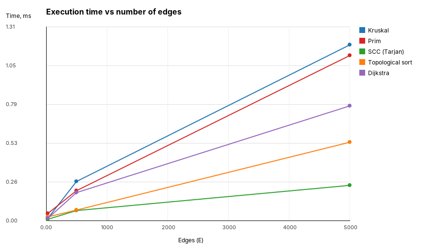
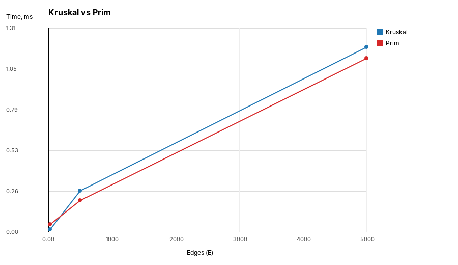
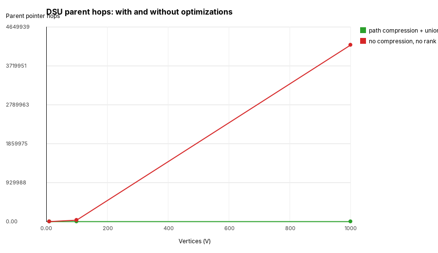

# Assignment 3 — Smart City Infrastructure and Route Planning

Java application that models a city as a graph and runs the planning algorithms on it:
minimum spanning tree (Kruskal and Prim), connectivity analysis (topological ordering and
strongly connected components) and shortest routes (Dijkstra). No external libraries.

## Build and run

```bash
javac -d out $(find src -name '*.java')

java -cp out Main demo     # worked example on a 7-district city
java -cp out Main test     # 48 correctness checks
java -cp out Main bench    # experiments -> results/tables, results/plots
```

## Project structure

```
src/graph/          Edge, WeightedGraph, Graph, Digraph, GraphGenerator
src/dsu/            DSU
src/mst/            Kruskal, Prim, MstResult
src/connectivity/   TopologicalSort (Kahn), Tarjan (SCC)
src/shortestpath/   Dijkstra
src/bench/          Benchmark, Plot
src/Main.java       demo / bench / test entry point
src/Tests.java      correctness checks
results/tables/     generated markdown tables
results/plots/      generated PNG plots
```

## 1. Overview

A district is a vertex, a road or infrastructure link is an edge, and the weight is the
construction cost or travel distance. Both graph types share the `WeightedGraph` interface
(`vertexCount`, `edgeCount`, `adjacent`, `edges`) and store adjacency lists, so every algorithm
works in O(V + E) memory and iterates only over real neighbours.

* `Graph` — undirected, used for infrastructure planning. `addEdge` stores one edge in the edge
  list and two directed entries in the adjacency lists.
* `Digraph` — directed, used for one-way roads and service dependencies.
* `Edge` — immutable `from`, `to`, `weight`, comparable by weight so Kruskal and Prim can put it
  straight into a sort or a priority queue.
* `GraphGenerator` — reproducible random graphs from a fixed seed.

## 2. Implementation

**DSU.** `parent` and `rank` arrays, iterative `find` with path compression, `union` by rank.
A second constructor `DSU(size, false)` disables both optimizations; the experiment in
`results/tables/dsu.md` uses it to show what the optimizations actually buy. The structure
counts `find` calls, `union` calls and parent-pointer hops, and keeps a live component counter,
so connectivity comes out of Kruskal for free.

**Kruskal.** Copy the edge list, sort it, then add an edge whenever `union` reports that its ends
were in different components. The loop stops as soon as V−1 edges are taken. The graph is
connected when the DSU is left with one component.

**Prim.** Lazy variant on a `PriorityQueue<Edge>`: push the edges of the current tree, pop the
cheapest, skip it if its target is already in the tree. After one component is exhausted the loop
restarts from the next unvisited vertex, so on a disconnected graph Prim builds a spanning forest
and returns exactly the same total weight as Kruskal instead of silently covering one component.

**Topological ordering.** Kahn's algorithm with an in-degree array and a queue of zero-in-degree
vertices. If fewer than V vertices are placed, the graph has a cycle: the result reports
`acyclic = false` and returns `null` instead of an invalid order.

**SCC.** Tarjan's algorithm — one DFS, `index`/`low` numbering and a stack of open vertices. Every
vertex gets exactly one component id, and `groups()` turns the id array into vertex lists.

**Dijkstra.** Binary heap (`PriorityQueue` of `{distance, vertex}`) with lazy deletion: a stale
heap entry is skipped by the `settled` flag instead of being removed. `previous` holds the
shortest-path tree, `pathTo` reconstructs a route, and unreachable vertices keep the sentinel
`Long.MAX_VALUE`. Negative weights are rejected with `IllegalArgumentException` before the search
starts.

**Why Dijkstra needs non-negative weights.** The algorithm settles a vertex the first time it is
popped and never revisits it, which is only correct when extending a path cannot make it shorter.
With a negative edge a longer-looking detour can later turn out cheaper — for example
`A→B = 2`, `A→C = 5`, `C→B = −4`: B is settled at 2, while the true distance is 1. A negative
cycle makes the shortest path undefined altogether. Bellman-Ford (O(V·E)) or Johnson's algorithm
handles such graphs.

## 3. Complexity Analysis

| Algorithm | Time | Space | Effect of V and E |
|---|---|---|---|
| DSU `find` / `union` (compression + rank) | O(α(V)) amortized | O(V) | effectively constant; α(V) ≤ 4 for any realistic V |
| DSU with only one optimization | O(log V) amortized | O(V) | tree height grows logarithmically |
| DSU with neither | O(V) worst case | O(V) | a union chain degenerates into a path |
| Kruskal | O(E log E + E·α(V)) | O(V + E) | sorting dominates, so cost is driven by E |
| Prim (binary heap, adjacency list) | O(E log E) | O(V + E) | each edge is pushed at most once, each pop is log of the heap size |
| Topological ordering (Kahn) | O(V + E) | O(V) | linear, one pass over vertices and edges |
| SCC (Tarjan) | O(V + E) | O(V) | linear, single DFS |
| Dijkstra (binary heap) | O((V + E) log V) | O(V + E) | E relaxations, up to E heap pushes |

Assumptions: adjacency lists, a binary heap (`java.util.PriorityQueue`), lazy deletion in Prim and
Dijkstra, and integer weights. The lazy heap holds up to E entries, which is why the Prim and
Dijkstra bounds carry `log E` rather than `log V` — for simple graphs these differ by a constant
factor since log E ≤ 2·log V.

## 4. Experimental Setup

| Graph | Vertices (V) | Edges (E) |
|---|---|---|
| Small | 10 | 30 |
| Medium | 100 | 500 |
| Large | 1 000 | 5 000 |

Generation (`GraphGenerator`, seed `20251021 + size index`, weights uniform in 1…100):

* **Undirected, MST experiments** — a random spanning tree is built first (each new vertex of a
  shuffled permutation attaches to a random earlier one), then random non-duplicate edges are
  added up to E. The result is always connected and has exactly E edges.
* **DAG, topological ordering** — vertices are shuffled into a random linear order and every edge
  goes from the earlier to the later endpoint, so the graph is acyclic by construction.
* **Random digraph, SCC and Dijkstra** — arbitrary distinct pairs `u → v`, duplicates rejected.
  Cycles appear naturally; the Large instance also leaves a few vertices unreachable from
  district 0.

Measurement: each algorithm is run 3 times to warm up the JIT and then 5 times with
`System.nanoTime()`; the tables report the average in milliseconds. Operation counters are taken
from a separate untimed run — edge examinations for Kruskal and Prim, DSU find/union/hop counts,
in-degree and adjacency updates for Kahn, DFS edge visits for Tarjan, edge relaxations for
Dijkstra.

## 5. Results

### MST — Kruskal vs Prim

| Graph | V | E | Kruskal, ms | Prim, ms | Kruskal weight | Prim weight | Kruskal edge checks | Prim edge checks | Connected |
|---|---|---|---|---|---|---|---|---|---|
| Small | 10 | 30 | 0.017 | 0.050 | 139 | 139 | 13 | 30 | yes |
| Medium | 100 | 500 | 0.267 | 0.207 | 1301 | 1301 | 257 | 500 | yes |
| Large | 1000 | 5000 | 1.195 | 1.122 | 12619 | 12619 | 4000 | 5000 | yes |

### DSU — effect of path compression and union by rank

| Graph | V | E | find calls | union calls | hops (compression + rank) | hops (neither) | ratio |
|---|---|---|---|---|---|---|---|
| Small | 10 | 30 | 60 | 30 | 43 | 216 | 5.02× |
| Medium | 100 | 500 | 1000 | 500 | 890 | 42 221 | 47.44× |
| Large | 1000 | 5000 | 10000 | 5000 | 8 985 | 4 227 217 | 470.47× |

### Topological ordering and SCC

| Graph | V | E | Topo, ms | Topo ops | DAG ordered | Cycle detected | SCC, ms | SCC ops | SCC count | Largest SCC |
|---|---|---|---|---|---|---|---|---|---|---|
| Small | 10 | 30 | 0.027 | 60 | yes | yes | 0.013 | 30 | 1 | 10 |
| Medium | 100 | 500 | 0.073 | 1000 | yes | yes | 0.069 | 500 | 1 | 100 |
| Large | 1000 | 5000 | 0.535 | 10000 | yes | yes | 0.242 | 5000 | 14 | 987 |

### Dijkstra from district 0

| Graph | V | E | Time, ms | Edge relaxations | Reachable | Unreachable | Longest shortest path |
|---|---|---|---|---|---|---|---|
| Small | 10 | 30 | 0.019 | 30 | 10 / 10 | 0 | 123 |
| Medium | 100 | 500 | 0.193 | 500 | 100 / 100 | 0 | 212 |
| Large | 1000 | 5000 | 0.781 | 4949 | 993 / 1000 | 7 | 335 |

### Plots









## 6. Comparison and Discussion

**Kruskal vs Prim.** Both always returned the same total weight — 139, 1301 and 12619 — which is
the expected behaviour for a connected weighted graph even when several different MSTs exist.
On the Small graph Kruskal is about three times faster: it examines only 13 of 30 edges before
collecting V−1 = 9 of them, while Prim pays for allocating and filling a priority queue on a
problem too tiny to amortize it. From the Medium graph on, Prim is slightly ahead (0.207 vs 0.267
ms, 1.122 vs 1.195 ms), because Kruskal sorts the whole edge list up front while Prim only ever
holds the frontier. The gap stays small — both are Θ(E log E) — and with E = 5·V in these
configurations the two algorithms are essentially interchangeable. The real difference is
structural: Kruskal reads a flat edge list and produces a spanning forest on a disconnected graph
without any extra work, Prim needs adjacency lists and an explicit restart loop.

**DSU optimizations.** The counts make the asymptotics visible. The number of `find` and `union`
calls is identical in both configurations — only the work inside `find` changes. With compression
and union by rank, parent-pointer hops grow linearly with the number of operations (43 → 890 →
8 985, i.e. under one hop per `find`, matching the near-constant α(V) bound). Without them the
same workload costs 216 → 42 221 → 4 227 217 hops: the trees degenerate into long chains, so the
cost per `find` grows with V and total work becomes roughly quadratic. The ratio widens from 5× to
470× over a 100× increase in V, exactly the trend the amortized analysis predicts.

**SCC.** Tarjan's runtime tracks V + E: 0.013 → 0.069 → 0.242 ms while the graph grows 100×, and
the operation counter is exactly E each time, since every edge is traversed once. The structure of
the random digraph changes with density: at V = 10 and V = 100 the whole graph is one giant
component, while at V = 1000 with E = 5000 the average out-degree of 5 is high enough for a giant
component of 987 vertices but leaves 13 singletons — the same vertices that Dijkstra reports as
unreachable.

**Topological ordering.** Kahn's algorithm is linear in practice too (0.027 → 0.073 → 0.535 ms),
and its counter is exactly 2E — E in-degree increments plus one adjacency update per edge. On the generated
DAGs it placed all V vertices every time; on the random digraphs, which contain cycles, it stopped
early and reported that no ordering exists in all three sizes. Cycle detection costs nothing
extra — it is the same single pass.

**Dijkstra.** Time grows from 0.019 to 0.781 ms, slightly faster than linear in E, which is the
log V factor of the heap. The relaxation counter equals E on Small and Medium but drops to 4949 on
Large: the 7 unreachable vertices are never settled, so their outgoing edges are never scanned.
That is also a direct check that unreachable vertices are handled rather than crashed on.

**Theory vs experiment.** All measured curves match the predicted shapes: linear for Kahn and
Tarjan, slightly super-linear for Kruskal, Prim and Dijkstra, and the DSU hop counts separate
near-constant from linear per-operation cost. The main deviation is at V = 10, where every
algorithm costs tens of microseconds regardless of its complexity class — at that size JVM warm-up,
allocation and measurement overhead dominate, and asymptotics say nothing useful.

## 7. Testing

`java -cp out Main test` runs 48 checks; all pass. Covered cases:

* **Small graphs** — hand-verified MST weight 6, Dijkstra distances 3 / 8 / 11 and the exact path
  `[0, 2, 1, 3, 4]`, a known 5-vertex digraph with exactly 3 SCCs.
* **Disconnected graphs** — Kruskal and Prim both report `connected = false`, find 2 components and
  agree on the spanning-forest weight 12.
* **Graphs containing cycles** — a 3-cycle is rejected by the topological sort (`order == null`)
  and recognised as a single SCC.
* **Multiple valid MSTs** — a 4-cycle of equal weights: both algorithms may pick different edges
  but return the same total weight 3.
* **Duplicate edge weights** — all-equal weights on a denser graph, weight 20 from both algorithms.
* **Unreachable vertices** — the distance stays at the sentinel, `reachable` is false and `pathTo`
  returns an empty list.
* **Single vertex** — MST weight 0 and connected, one SCC, a valid one-element ordering, distance
  to the source 0.
* **Generated graphs at all three sizes** — Kruskal and Prim agree on the weight, the MST has
  exactly V−1 edges, the generator produces exactly E edges.
* **Topological order validity** — on a 100-vertex DAG every edge is verified to go forward in the
  returned order.
* **SCC partition** — on a 1000-vertex digraph every component id is in range and the component
  sizes sum to V, so each vertex belongs to exactly one SCC.
* **Negative weights** — Dijkstra throws `IllegalArgumentException` instead of returning a wrong
  answer.

## 8. Conclusion

For connecting all districts at minimum cost, Kruskal and Prim are equally valid and produced
identical totals on every instance; at the densities tested the timing difference stays within a
few tenths of a millisecond. Kruskal is the better default when the input is a plain edge list or
the network may be disconnected, Prim when the graph is dense and already stored as adjacency
lists, since it never sorts all E edges.

The DSU is what makes Kruskal practical, and the experiment shows it is not a micro-optimization:
without path compression and union by rank the same workload did 470× more pointer work at
V = 1000, and the gap widens with every increase in size.

For connectivity questions, Kahn's algorithm and Tarjan's algorithm are both single linear passes
and were the cheapest algorithms in the whole suite. Kahn answers "can these works be scheduled at
all" and returns the schedule or proves a cycle exists; Tarjan answers "which districts are
mutually reachable under one-way roads" and exposes the unreachable remainder.

For route planning, Dijkstra with a binary heap is the right tool as long as weights are
non-negative, which holds for distances and travel times. If the model ever needs negative values —
subsidies, refunds, elevation gain — it must be replaced by Bellman-Ford, since Dijkstra's settle
once rule is no longer valid.
